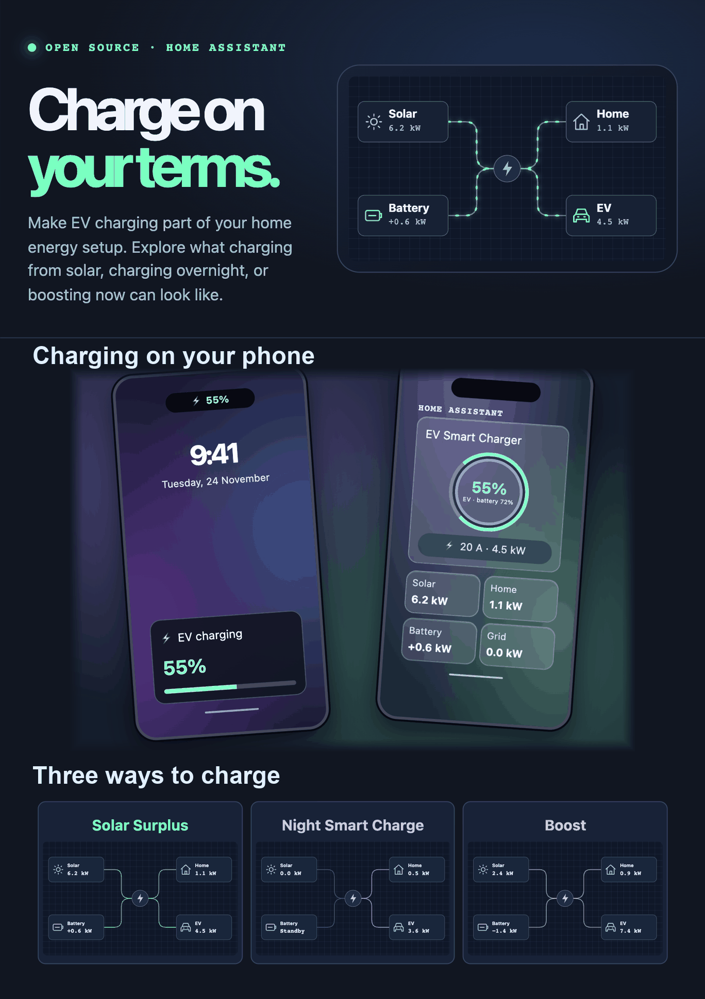

Make EV charging work with your home's energy in Home Assistant. Use excess solar, balance the car and home battery, or schedule an overnight top-up using tomorrow's solar forecast. Works with single- or three-phase setups and with or without a home battery.

## Charging on your phone

- **iPhone Live Activities:** See charging progress on the Lock Screen or Dynamic Island on supported devices. Updates show snapshots, not continuous telemetry. [Set up Live Activities](https://github.com/antbald/ha-ev-smart-charger/blob/master/docs/user-guide.md#ev-charging-live-activities--live-updates).
- **Liquid Glass dashboard:** See EV and home battery levels, solar, household consumption, and grid power in one place. The dashboard is optional.

## Charge your way

- **Solar Surplus** adjusts the charging current to use available solar, with grid-import protection.
- **Night Smart Charge** plans an overnight top-up using tomorrow’s solar forecast, with grid or home battery charging as configured.
- **Boost** gives the car charging priority now or on a schedule and stops at your chosen target.

**[Try the interactive charging demo ↗](https://antbald.github.io/ha-ev-smart-charger/)**

## Compatibility

- **Home Assistant Core 2024.4+**. The optional iPhone Live Activities feature requires **Core 2026.7+**, **iOS 17.2+**, and a compatible Home Assistant Companion App.
- A Home Assistant integration for your wallbox, local or cloud. The wallbox needs an on/off switch **or both Start and Stop buttons**, plus an adjustable current entity: `number`, `input_number`, `select`, or `input_select`. A charger status sensor is optional but strongly recommended with buttons.
- Map your EV battery percentage and solar production, household consumption, and grid power sensors. Home battery SOC and solar forecast are optional. See [full prerequisites and setup](https://github.com/antbald/ha-ev-smart-charger/blob/master/docs/user-guide.md#requirements).

## Install

**Home Assistant 2026.11+ (built-in Marketplace):** Open **Settings → Marketplace**, search for **EV Smart Charger**, and select **Install**. The integration setup opens after installation.

**Older Home Assistant versions (HACS):** Open **HACS**, search for **EV Smart Charger**, select **Download**, and restart Home Assistant. Then go to **Settings → Devices & services → Add integration** and choose **EV Smart Charger**.

[Open in Home Assistant](https://my.home-assistant.io/redirect/hacs_repository/?owner=antbald&repository=ha-ev-smart-charger&category=integration)

### Optional dashboard

Opt in during setup, or press **Build Custom Dashboard** later from the integration's entities. Either opens a notification with a link to review and explicitly create the dashboard as a Home Assistant administrator. The integration does not replace or delete existing dashboards. [Dashboard setup guide](https://github.com/antbald/ha-ev-smart-charger/blob/master/docs/dashboard-builder.md)

## More information

[Full user guide](https://github.com/antbald/ha-ev-smart-charger/blob/master/docs/user-guide.md) · [Release notes](https://github.com/antbald/ha-ev-smart-charger/releases) · [Report an issue](https://github.com/antbald/ha-ev-smart-charger/issues) · [MIT license](https://github.com/antbald/ha-ev-smart-charger/blob/master/LICENSE)
